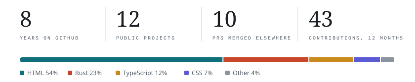
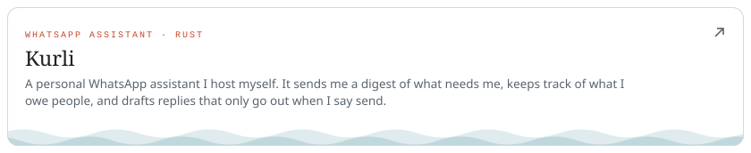
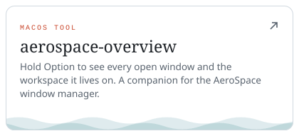
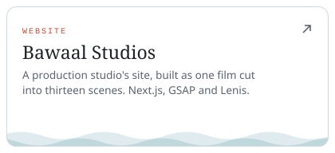
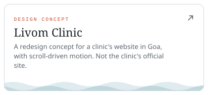
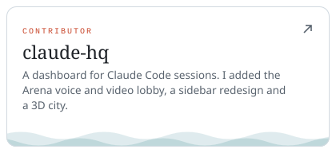
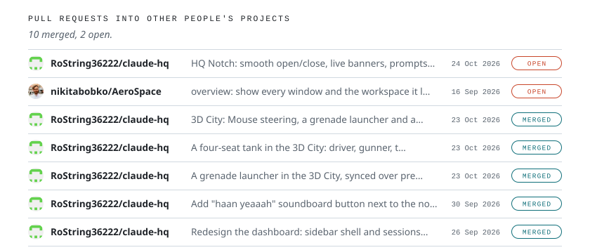
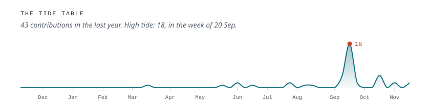

<!-- Generated by build/build.py. Edit that file or profile.json, not this one. -->

<a href="https://github.com/shreyash73?tab=repositories"><picture><source media="(prefers-color-scheme: dark)" srcset="assets/dark/hero.svg"></picture></a> 
<picture><source media="(prefers-color-scheme: dark)" srcset="assets/dark/numbers.svg"></picture> 
<a href="https://github.com/shreyash73/kurli"><picture><source media="(prefers-color-scheme: dark)" srcset="assets/dark/project-0.svg"></picture></a> 
<a href="https://github.com/shreyash73/aerospace-overview"><picture><source media="(prefers-color-scheme: dark)" srcset="assets/dark/project-1.svg"></picture></a><a href="https://shreyash73.github.io/bawaal-studios/"><picture><source media="(prefers-color-scheme: dark)" srcset="assets/dark/project-2.svg"></picture></a> 
<a href="https://shreyash73.github.io/livom-concept/"><picture><source media="(prefers-color-scheme: dark)" srcset="assets/dark/project-3.svg"></picture></a><a href="https://github.com/RoString36222/claude-hq"><picture><source media="(prefers-color-scheme: dark)" srcset="assets/dark/project-4.svg"></picture></a> 
<a href="https://github.com/search?q=author%3Ashreyash73%20is%3Apr%20is%3Amerged%20-user%3Ashreyash73&type=pullrequests"><picture><source media="(prefers-color-scheme: dark)" srcset="assets/dark/pulls.svg"></picture></a> 
<picture><source media="(prefers-color-scheme: dark)" srcset="assets/dark/tide.svg"></picture>

<b>Pull requests as a list</b>, with links

 

| Project | Pull request | Status | Date |
|---|---|---|---|
| RoString36222/claude-hq | [HQ Notch: smooth open/close, live banners, prompts stay open, kitty tab switching](https://github.com/RoString36222/claude-hq/pull/173) | Open | 24 Oct 2026 |
| nikitabobko/AeroSpace | [overview: show every window and the workspace it lives on while a modifier is held](https://github.com/nikitabobko/AeroSpace/pull/2271) | Open | 16 Sep 2026 |
| RoString36222/claude-hq | [3D City: Mouse steering, a grenade launcher and a four-seat tank (3.16.0)](https://github.com/RoString36222/claude-hq/pull/168) | Merged | 23 Oct 2026 |
| RoString36222/claude-hq | [A four-seat tank in the 3D City: driver, gunner, two riders (3.17.0)](https://github.com/RoString36222/claude-hq/pull/167) | Merged | 23 Oct 2026 |
| RoString36222/claude-hq | [A grenade launcher in the 3D City, synced over presence (3.16.0)](https://github.com/RoString36222/claude-hq/pull/165) | Merged | 23 Oct 2026 |
| RoString36222/claude-hq | [Add "haan yeaaah" soundboard button next to the notification bell](https://github.com/RoString36222/claude-hq/pull/39) | Merged | 30 Sep 2026 |
| RoString36222/claude-hq | [Redesign the dashboard: sidebar shell and sessions-first Live view](https://github.com/RoString36222/claude-hq/pull/30) | Merged | 26 Sep 2026 |
| RoString36222/claude-hq | [Arena: screen sharing, live status, unread badge, call shortcuts](https://github.com/RoString36222/claude-hq/pull/22) | Merged | 25 Sep 2026 |
| RoString36222/claude-hq | [Arena: video in the voice channel](https://github.com/RoString36222/claude-hq/pull/20) | Merged | 24 Sep 2026 |
| RoString36222/claude-hq | [Arena chat: server-side history, cleaning and rate limit](https://github.com/RoString36222/claude-hq/pull/14) | Merged | 24 Sep 2026 |
| RoString36222/claude-hq | [Arena: lobby voice channel (WebRTC)](https://github.com/RoString36222/claude-hq/pull/12) | Merged | 24 Sep 2026 |
| RoString36222/claude-hq | [Arena: lobby chat — talk to everyone online](https://github.com/RoString36222/claude-hq/pull/10) | Merged | 24 Sep 2026 |

Rebuilt daily from the GitHub API by <a href="build/build.py">build/build.py</a>.

